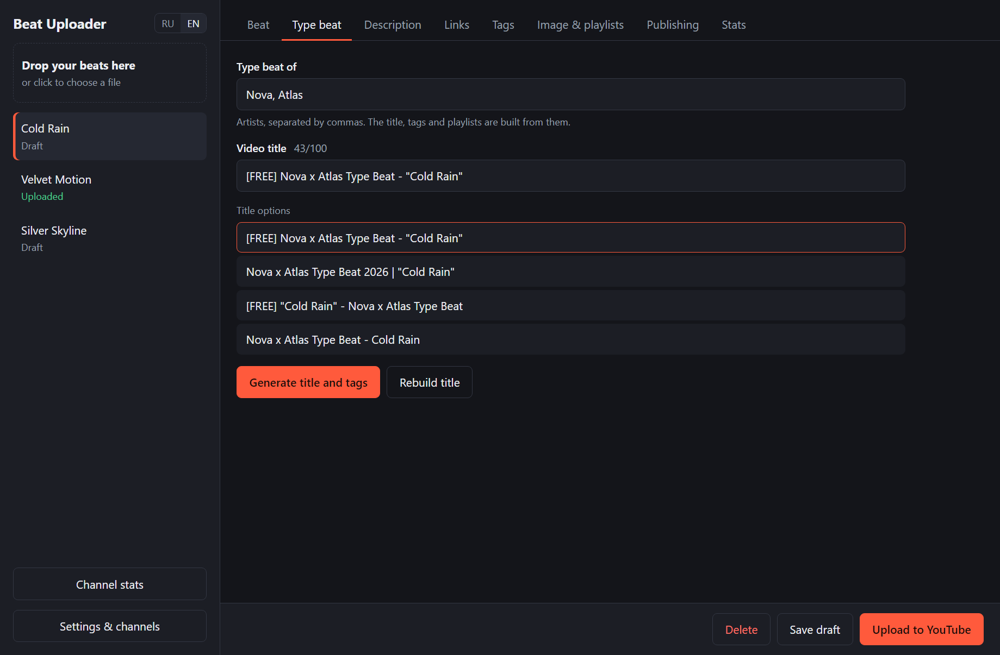
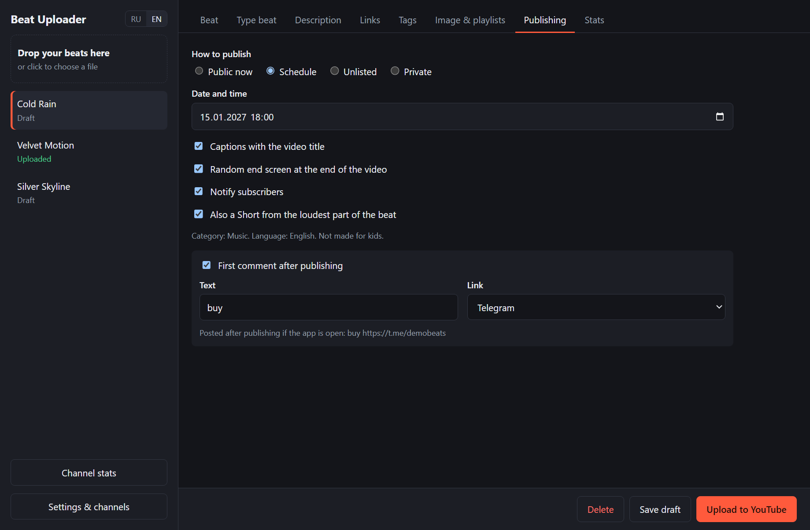
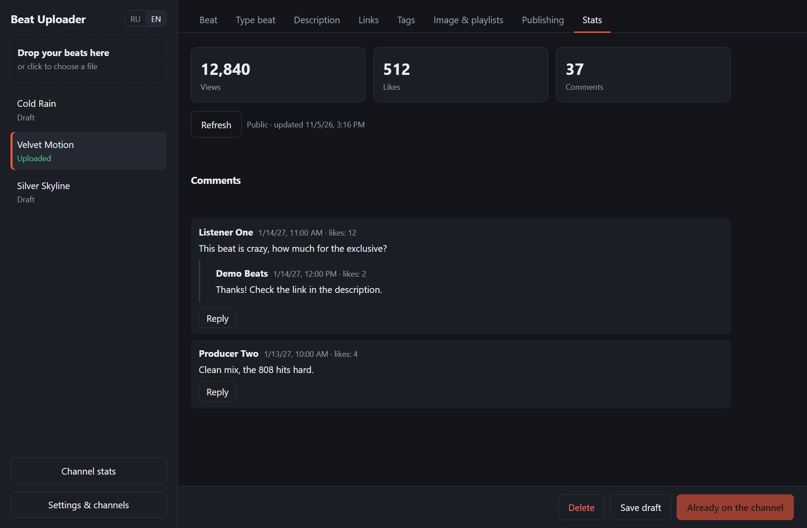
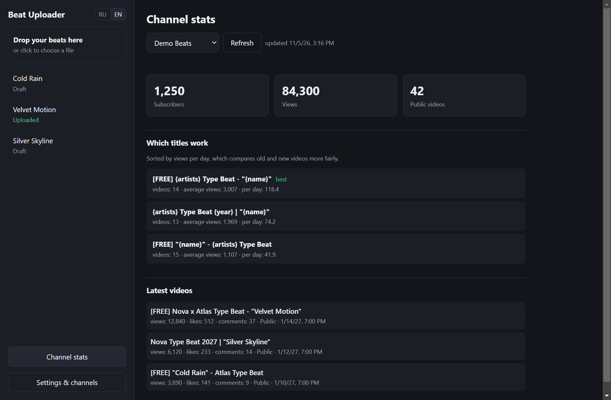

# Beat Uploader

**English** | [Русский](README.ru.md)

Drop in a beat and get a finished YouTube upload: title, description, tags, video, thumbnail, playlists, captions and a Short. A Windows desktop app for type beat producers.



## What it does

- **Auto-fill from the file name.** `[FREE] Drake x Future Type Beat - Cold Rain 140bpm Cm.mp3` fills in the artists, name, BPM and key, then finds tags and a photo. Photos and random names do not repeat.
- **Video from a picture.** The image stays whole in the center with a blurred copy behind it, for the full length of the beat.
- **Shorts.** A vertical clip from the loudest part of the beat, uploaded separately without notifying subscribers.
- **Title testing.** New beats take your title templates in turn, and the app shows which one earns the most views per day.
- **Tags.** Description tags come from prozavr, the YouTube tags field comes from RapidTags. Results are remembered for 7 days.
- **Publishing.** Public, scheduled, unlisted or private, with playlists, captions, and an automatic first comment with your BeatStars or Telegram link.
- **Stats and comments.** Views, likes and comments per video, channel totals, and replies from inside the app.
- **Photo search.** Find an image on the web or Pinterest and set it with one click.
- **Several channels and two languages.** Add channels from the channel list, switch between English and Russian at any time.

| Publishing | Video stats | Channel stats |
| --- | --- | --- |
|  |  |  |

## Install

Download `Beat Uploader Setup.exe` from [Releases](../../releases) and run it. Windows may warn you because the app has no paid code signature: click **More info**, then **Run anyway**.

You also need Chrome or Edge, which the app uses to get tags from RapidTags.

## Connect your channel

The app uses the official YouTube API, so you need your own free Google project. This takes about 10 minutes and is only done once.

1. Create a project in [Google Cloud Console](https://console.cloud.google.com/projectcreate).
2. Enable [YouTube Data API v3](https://console.cloud.google.com/apis/library/youtube.googleapis.com).
3. Open [Google Auth Platform](https://console.cloud.google.com/auth/overview), enter an app name and your email, and choose **External**.
4. On the [Audience](https://console.cloud.google.com/auth/audience) page, add the Google account that owns your channel as a test user.
5. [Create a client](https://console.cloud.google.com/auth/clients/create) of the **Desktop app** type and click **Download JSON**.
6. In the app, open **Settings & channels**, click **Load key file**, then **Connect channel**.

Google will warn that the app is unverified. It is your own project, so click **Advanced** and continue.

**Permanent access.** While a project is in Testing, Google revokes access every 7 days. To avoid this, publish the project. Google requires a public home page and privacy policy first. The `site` folder has a ready template for Cloudflare Workers: edit it, run `npx wrangler deploy` inside the folder, enter the addresses on the Branding page, then click **Publish app** on the Audience page and connect the channel once more.

## YouTube limits

- **Quota.** By default, 100 uploads and 10,000 units a day for everything else. A beat with captions, thumbnail and a playlist uses about 500 units, so about 20 beats a day. A new playlist adds 50 and a comment adds 50.
- **End screens.** The API cannot add clickable end screen elements. The app burns a random image or clip from your folder into the last seconds, and clickable elements can only be added in YouTube Studio.
- **Drafts.** The API has no draft status, so drafts live in the app. **Private** uploads the video so only you can see it.
- **Country.** The API has no per-video country, so a button in settings sets it for the whole channel.
- **Pinned comments.** The API cannot pin comments.
- **Thumbnails.** Custom thumbnails need a [verified channel](https://www.youtube.com/verify).
- **Scheduled comments.** The first comment on a scheduled video is posted after it goes live while the app is open, otherwise on the next launch.

Pictures found through search belong to their authors. Make sure you may use them, and keep in mind that very long tag lists can look like spam to YouTube.

## Your data

Settings and drafts are stored in `%APPDATA%\beat-uploader`. Channel access and the client secret are encrypted with Windows data protection. The app never sees your Google password, and nothing is sent to the developer. See [site/worker.js](site/worker.js) for the full privacy policy text.

## For developers

```bash
npm install
npm start
npm test
npm run dist
```

`npm run dist` builds the installer into `dist`. It fails if the project path contains non-Latin characters, so build from a Latin-only path.

What changed in each version: [CHANGELOG.md](CHANGELOG.md).

## Author

Made by jelos8vetoi. Telegram: [t.me/jelos8vetoi](https://t.me/jelos8vetoi)

## License

[MIT](LICENSE). You can use and change the code freely as long as you keep the copyright notice.
