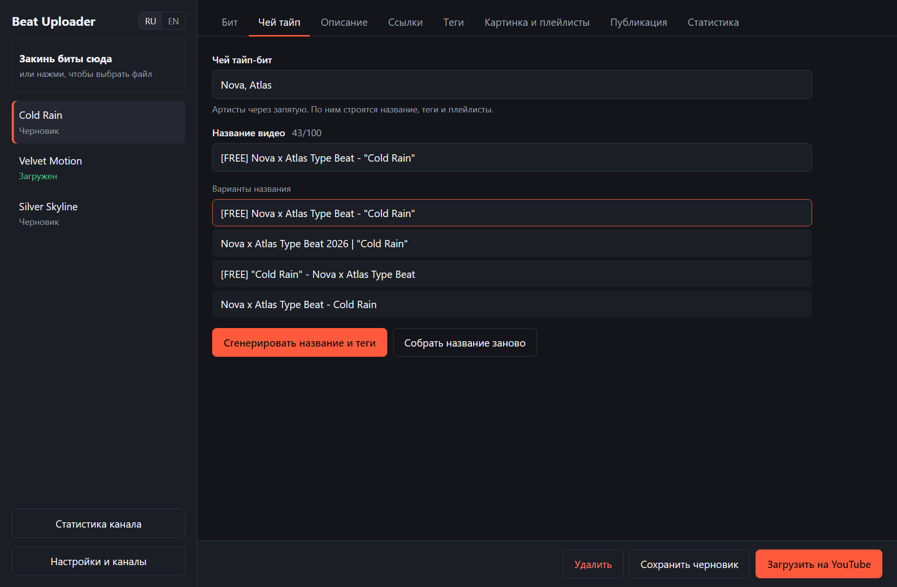
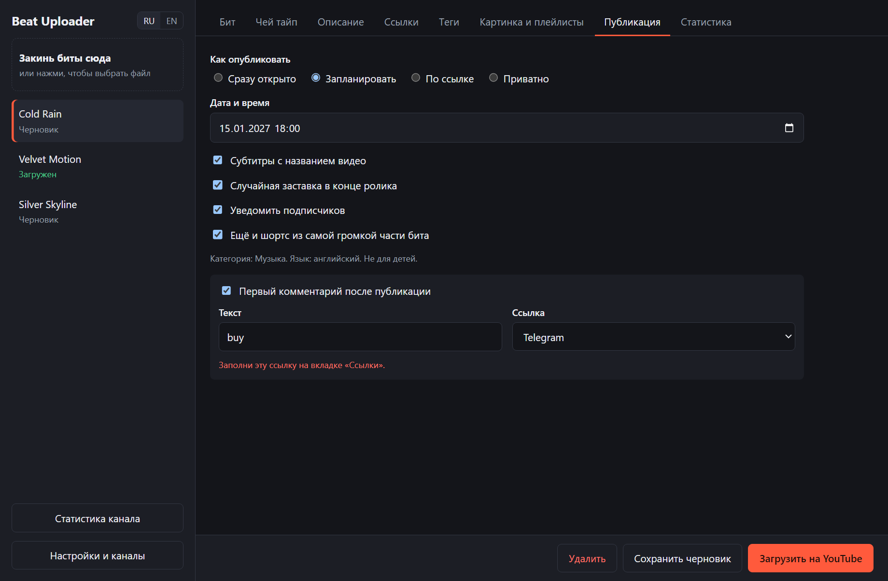
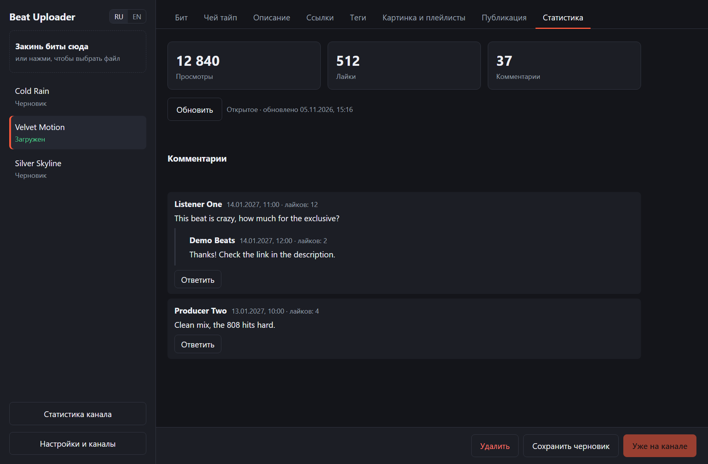
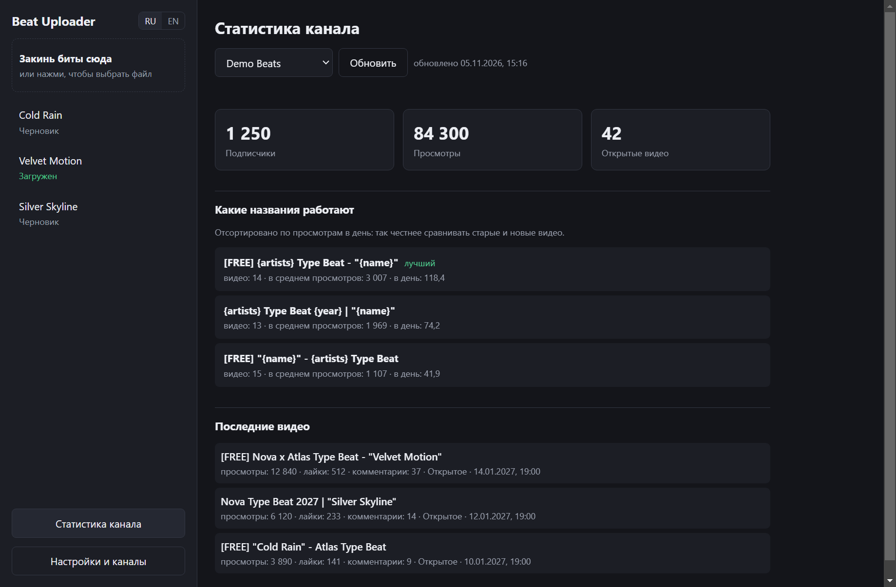

# Beat Uploader

[English](README.md) | **Русский**

Закидываешь бит и получаешь готовую заливку на YouTube: название, описание, теги, видео, обложку, плейлисты, субтитры и шортс. Программа для Windows для тех, кто делает тайп-биты.



## Что умеет

- **Автоподбор по имени файла.** Из `[FREE] Drake x Future Type Beat - Cold Rain 140bpm Cm.mp3` берутся артисты, название, BPM и тональность, затем подбираются теги и фото. Фото и случайные названия не повторяются.
- **Видео из картинки.** Картинка целиком по центру, за ней размытая копия, и так на всю длину бита.
- **Шортсы.** Вертикальный отрывок из самой громкой части бита заливается отдельно и без уведомления подписчикам.
- **Сравнение названий.** Новые биты получают твои шаблоны по очереди, а приложение показывает, какой набирает больше просмотров в день.
- **Теги.** Теги в описание идут с prozavr, поле тегов YouTube заполняется с RapidTags. Результаты запоминаются на 7 дней.
- **Публикация.** Открыто, по расписанию, по ссылке или приватно, с плейлистами, субтитрами и автоматическим первым комментарием со ссылкой на BeatStars или Telegram.
- **Статистика и комментарии.** Просмотры, лайки и комментарии по каждому видео, общие цифры канала и ответы прямо из приложения.
- **Поиск фото.** Находишь картинку в интернете или на Pinterest и ставишь её одним нажатием.
- **Несколько каналов и два языка.** Каналы добавляются прямо из списка, язык переключается в любой момент.

| Публикация | Статистика видео | Статистика канала |
| --- | --- | --- |
|  |  |  |

## Установка

Скачай `Beat Uploader Setup.exe` в разделе [Releases](../../releases) и запусти. Windows может предупредить, что у программы нет платной цифровой подписи: нажми **Подробнее**, затем **Выполнить в любом случае**.

Ещё нужен Chrome или Edge: через него приложение получает теги с RapidTags.

## Подключение канала

Приложение работает через официальный YouTube API, поэтому нужен свой бесплатный проект Google. Это около 10 минут и только один раз.

1. Создай проект в [Google Cloud Console](https://console.cloud.google.com/projectcreate).
2. Включи [YouTube Data API v3](https://console.cloud.google.com/apis/library/youtube.googleapis.com).
3. Открой [Google Auth Platform](https://console.cloud.google.com/auth/overview), впиши название и почту, выбери **External**.
4. На странице [Audience](https://console.cloud.google.com/auth/audience) добавь в тестовые пользователи аккаунт Google, на котором твой канал.
5. [Создай ключ](https://console.cloud.google.com/auth/clients/create) типа **Desktop app** и нажми **Download JSON**.
6. В приложении открой **Настройки и каналы**, нажми **Загрузить файл ключа**, затем **Подключить канал**.

Google предупредит, что приложение не проверено. Это твой собственный проект: нажми **Advanced** и продолжай.

**Постоянный доступ.** Пока проект в режиме Testing, Google отзывает доступ раз в 7 дней. Чтобы этого не было, опубликуй проект. Для этого Google требует открытые страницы сайта и политики конфиденциальности. В папке `site` лежит готовый шаблон для Cloudflare Workers: поправь его, запусти `npx wrangler deploy` из этой папки, впиши адреса на странице Branding, нажми **Publish app** на странице Audience и подключи канал ещё раз.

## Ограничения YouTube

- **Лимиты.** По умолчанию 100 загрузок и 10 000 единиц в день на всё остальное. Бит с субтитрами, обложкой и плейлистом тратит около 500 единиц, то есть примерно 20 битов в день. Новый плейлист добавляет 50, комментарий ещё 50.
- **Конечная заставка.** API не умеет добавлять кликабельные элементы заставки. Приложение вшивает случайную картинку или ролик из твоей папки в последние секунды, а кликабельные элементы можно добавить только в YouTube Studio.
- **Черновики.** В API нет статуса черновика, поэтому черновики хранятся в приложении. Режим **Приватно** заливает видео так, что его видишь только ты.
- **Страна.** В API нет страны для отдельного видео, поэтому кнопка в настройках ставит её всему каналу.
- **Закреплённые комментарии.** API не умеет закреплять комментарии.
- **Обложки.** Своя обложка работает только на [подтверждённом канале](https://www.youtube.com/verify).
- **Запланированные комментарии.** Первый комментарий к запланированному видео уходит после выхода, если приложение открыто, иначе при следующем запуске.

Картинки из поиска принадлежат их авторам, проверяй, что их можно использовать. И учти: очень длинные списки тегов YouTube может посчитать спамом.

## Твои данные

Настройки и черновики хранятся в `%APPDATA%\beat-uploader`. Доступ к каналу и Client Secret зашифрованы средствами Windows. Приложение не видит пароль Google, а разработчику ничего не отправляется. Полный текст политики конфиденциальности: [site/worker.js](site/worker.js).

## Для разработчиков

```bash
npm install
npm start
npm test
npm run dist
```

`npm run dist` собирает установщик в папку `dist`. Сборка падает, если в пути к проекту есть кириллица, поэтому собирай из папки с путём на латинице.

Что менялось в каждой версии: [CHANGELOG.ru.md](CHANGELOG.ru.md).

## Автор

Сделал jelos8vetoi. Telegram: [t.me/jelos8vetoi](https://t.me/jelos8vetoi)

## Лицензия

[MIT](LICENSE). Код можно свободно использовать и менять, если сохранять указание авторства.
